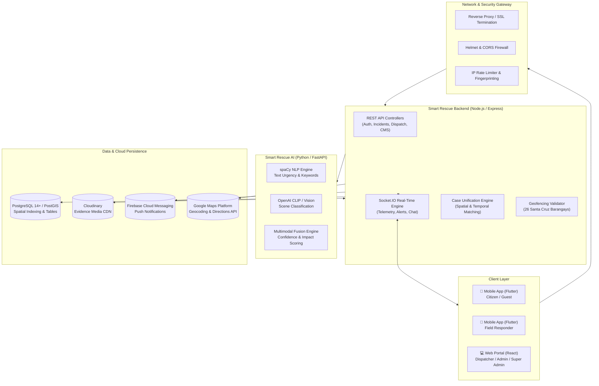
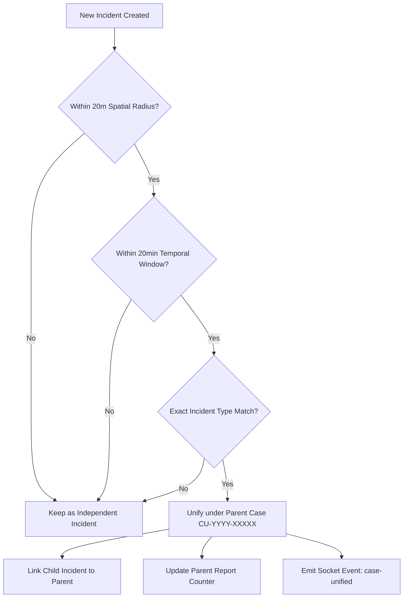
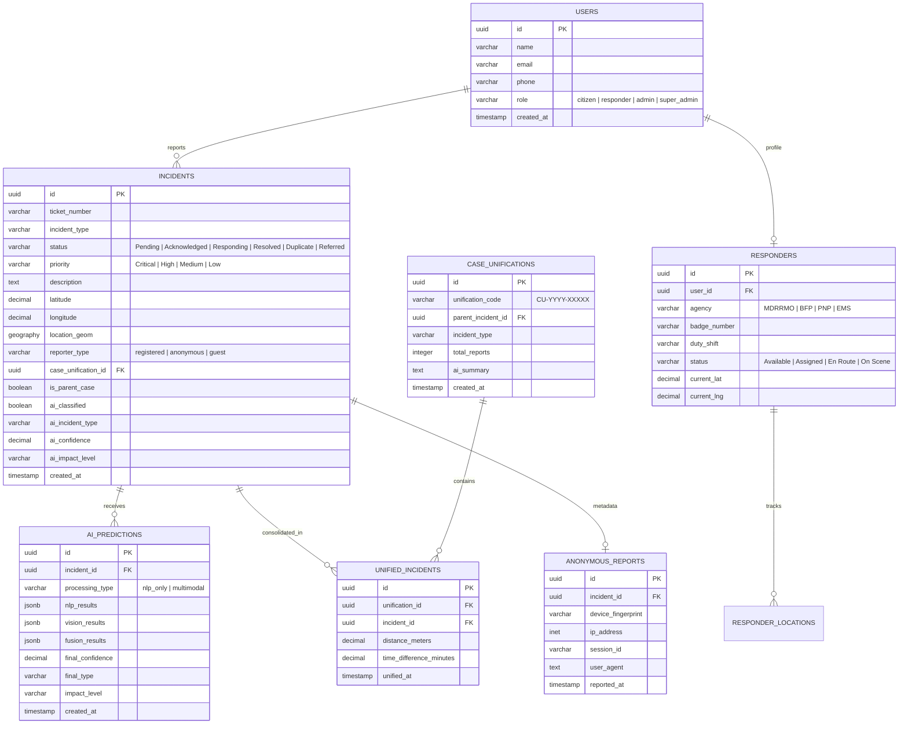

# 🚨 SMART RESCUE: COMPREHENSIVE SYSTEM MANUAL
**Municipal Disaster & Emergency Response Management System**  
*Municipality of Santa Cruz, Laguna — Municipal Disaster Risk Reduction and Management Office (MDRRMO)*

---

## 📑 TABLE OF CONTENTS
1. [Executive Overview & System Objectives](#1-executive-overview--system-objectives)
2. [High-Level System Architecture](#2-high-level-system-architecture)
3. [Technology Stack & Frameworks](#3-technology-stack--frameworks)
4. [User Roles & Access Control Matrix (RBAC)](#4-user-roles--access-control-matrix-rbac)
5. [Core Subsystems & Functional Specifications](#5-core-subsystems--functional-specifications)
   - 5.1 [Incident Reporting & Geofencing Engine](#51-incident-reporting--geofencing-engine)
   - 5.2 [Multi-Modal AI Classification Subsystem](#52-multi-modal-ai-classification-subsystem)
   - 5.3 [Case Unification Engine ("The Triad of Unification")](#53-case-unification-engine-the-triad-of-unification)
   - 5.4 [Live Responder Tracking & Dispatch Management](#54-live-responder-tracking--dispatch-management)
   - 5.5 [Public Shared Heatmap & Privacy Engine](#55-public-shared-heatmap--privacy-engine)
   - 5.6 [AI Description Suggestions](#56-ai-description-suggestions)
   - 5.7 [Real-Time Communication & Sirens](#57-real-time-communication--sirens)
   - 5.8 [Emergency Facilities & Evacuation Management](#58-emergency-facilities--evacuation-management)
   - 5.9 [Weather Monitoring & Early Warning System](#59-weather-monitoring--early-warning-system)
   - 5.10 [Content Management System (CMS) & Emergency Hotlines](#510-content-management-system-cms--emergency-hotlines)
6. [Database Schema & Data Architecture](#6-database-schema--data-architecture)
7. [API & Real-Time Socket.IO Protocol](#7-api--real-time-socketio-protocol)
8. [Standard Operating Procedures (SOP) & Lifecycle Workflows](#8-standard-operating-procedures-sop--lifecycle-workflows)
9. [Installation, Configuration & Deployment Guide](#9-installation-configuration--deployment-guide)
10. [Troubleshooting & Maintenance Procedures](#10-troubleshooting--maintenance-procedures)

---

## 1. EXECUTIVE OVERVIEW & SYSTEM OBJECTIVES

**Smart Rescue** is an enterprise-grade municipal emergency response and disaster coordination platform custom-tailored for the **Municipality of Santa Cruz, Laguna** (serving all 26 constituent barangays) and operated under the jurisdiction of the **Municipal Disaster Risk Reduction and Management Office (MDRRMO)**.

### 1.1 Mission & Value Proposition
- **Rapid Reporting**: Enables citizens and guests to report life-threatening emergencies with real-time GPS coordinates, reverse geocoding, and photo attachments in under 15 seconds.
- **Multi-Modal AI Triage**: Automatically analyzes emergency descriptions (NLP) and photo evidence (Computer Vision via CLIP/TensorFlow) to predict emergency categories, confidence levels, and severity impact without blocking reporting queues.
- **Intelligent Case Unification**: Prevents duplicate resource dispatching by automatically consolidating multiple incoming reports for the same incident using a strict spatial, temporal, and categorical rule set (**The Triad of Unification**).
- **Live Fleet Tracking & Dispatch**: Empowers dispatchers with real-time GPS telemetry of emergency responders on duty shifts, live route polyline navigation, distance-to-scene calculations, and instant assignment.
- **Public Transparency with Privacy**: Provides citizens with a live, privacy-protected incident heatmap (coordinates rounded to ~111m with all PII scrubbed).

---

## 2. HIGH-LEVEL SYSTEM ARCHITECTURE

Smart Rescue implements a modern, decoupled microservices-and-client architecture built around a centralized real-time event bus and spatial relational database.



---

## 3. TECHNOLOGY STACK & FRAMEWORKS

| Tier | Component | Technology / Library | Role & Purpose |
|---|---|---|---|
| **Mobile Client** | Smart Rescue Mobile | **Flutter 3.x (Dart 3)** | Cross-platform mobile app for Citizens and Responders |
| | State Management | **Provider 6.1** | Reactive state handling across views |
| | Maps & Spatial | **google_maps_flutter 2.6**, **flutter_map 7.0**, **geolocator 11.0** | Live GPS location tracking, navigation, public heatmap |
| | Real-Time & Push | **socket_io_client 2.0**, **firebase_messaging 14.7** | Instant event notifications and live telemetry broadcasting |
| | Security & Storage | **flutter_secure_storage**, **shared_preferences** | Encrypted JWT token storage and offline preferences |
| **Web Dashboard** | Smart Rescue Web | **React 18 (SPA), Vite / CRA** | Command & control web portal for dispatchers and administrators |
| | UI & Layout | **Bootstrap 5.3, React-Bootstrap, Lucide React** | Responsive administrative interface and data tables |
| | Mapping Engine | **Leaflet 1.9, React-Leaflet 4.2, Leaflet.heat 0.2** | Operational command map and public incident heatmap |
| | Visual Analytics | **Chart.js 4.4, React-Chartjs-2, Recharts 3.8** | Real-time emergency trends and KPI dashboards |
| | Export Tools | **jspdf 4.2, jspdf-autotable, html2canvas** | Official Situation Incident Report generation |
| **Backend API** | Smart Rescue Backend | **Node.js 18+, Express 4.18** | Primary business logic, REST APIs, and authentication |
| | Real-Time Engine | **Socket.IO 4.6** | Bidirectional low-latency communications |
| | Security | **Helmet 7.1, CORS, jsonwebtoken 9.0, bcryptjs 2.4** | Header hardening, JWT authentication, password hashing |
| | Logging & Audit | **Winston 3.11, Response-Time** | Structured audit logging and API latency telemetry |
| **AI Microservice** | Smart Rescue AI | **Python 3.9+, FastAPI** | High-performance multi-modal machine learning service |
| | Vision Pipeline | **OpenAI CLIP, PyTorch, PIL** | Scene visual classification (Fire, Flood, Road Crash) |
| | NLP Pipeline | **spaCy, Regex Lexicon** | Text emergency intent, priority keyword extraction |
| **Data Tier** | Primary Database | **PostgreSQL 14+ with PostGIS Extension** | Relational data, geospatial queries (`ST_DWithin`, `ST_Distance`) |
| **External APIs** | Third-Party Services | **Google Maps API, Cloudinary, Twilio, Nodemailer** | Navigation, image storage, SMS alerts, email alerts |

---

## 4. USER ROLES & ACCESS CONTROL MATRIX (RBAC)

Smart Rescue enforces strict Role-Based Access Control (RBAC) via JSON Web Tokens (JWT):

```
+---------------------------------------------------------------------------------------+
| ROLE           | PORTAL   | SCOPE & CAPABILITIES                                      |
+---------------------------------------------------------------------------------------+
| Guest/Citizen  | Mobile   | • Anonymous emergency reporting with device fingerprint   |
| (Unregistered) |          | • View privacy-protected incident heatmap (view-only)     |
|                |          | • View emergency hotlines, evacuation facilities & tips   |
+---------------------------------------------------------------------------------------+
| Citizen        | Mobile   | • Authenticated emergency reporting (instant GPS capture) |
| (Registered)   |          | • Track status of personal submitted incidents             |
|                |          | • Direct two-way emergency chat with MDRRMO dispatchers   |
|                |          | • View evacuation center statuses & localized weather     |
+---------------------------------------------------------------------------------------+
| Responder      | Mobile   | • Active duty shift check-in & status toggle              |
|                |          | • Receive incident dispatch assignments with siren alerts |
|                |          | • Live turn-by-turn routing to incident coordinates       |
|                |          | • Stream real-time GPS telemetry back to command center   |
|                |          | • Update on-scene progress (En Route -> On Scene -> Done) |
+---------------------------------------------------------------------------------------+
| Dispatcher /   | Web      | • Command & control dashboard and incident queue triage   |
| Admin          |          | • AI classification review & priority overrides           |
|                |          | • Manual emergency incident logging (call-taker intake)   |
|                |          | • Assign and dispatch on-duty emergency units             |
|                |          | • Case Unification inspection and consolidated management |
|                |          | • Inter-agency incident referrals                         |
+---------------------------------------------------------------------------------------+
| Super Admin    | Web      | • All Dispatcher capabilities                             |
|                |          | • User role administration & shift configuration          |
|                |          | • Content Management (hotlines, safety guidelines)        |
|                |          | • Evacuation facility management & capacity updates       |
|                |          | • Official SITREP exports & comprehensive analytics       |
+---------------------------------------------------------------------------------------+
```

---

## 5. CORE SUBSYSTEMS & FUNCTIONAL SPECIFICATIONS

### 5.1 Incident Reporting & Geofencing Engine
- **Standardized Incident Categories**:
  - `Fire`
  - `Medical Emergency`
  - `Flood`
  - `Earthquake`
  - `Road Crash`
  - `Peace and Order`
  - `Water Rescue`
  - `Common Home Accident`
  - `Other`
- **Geofence Boundary (Santa Cruz, Laguna)**:
  - Validates coordinates across all **26 Barangays**: *Alipit, Bagumbayan, Bubukal, Calios, Duhat, Gatid, Jasaan, Labuin, Malinao, Oogong, Pagsawitan, Palasan, Patimbao, Poblacion I, Poblacion II, Poblacion III, Poblacion IV, Poblacion V, San Jose, San Juan, San Pablo Norte, San Pablo Sur, Santisima Cruz, Santo Angel Central, Santo Angel Norte, Santo Angel Sur*.
  - Out-of-bounds reports trigger a notice and immediate referral to provincial or neighboring municipal centers.
- **Anonymous / Guest Reporting Mode**:
  - Requires no sign-up or login.
  - Collects zero personally identifiable information (PII).
  - Captures hardware fingerprint, session UUID, and network IP exclusively for rate-limiting and anti-abuse protection.

---

### 5.2 Multi-Modal AI Classification Subsystem
The AI subsystem operates asynchronously on incident creation without delaying the user response:
1. **Asynchronous Trigger**: Citizen submits incident $\to$ DB record created $\to$ HTTP 201 returned to user within $\mathbf{< 1\text{ second}}$.
2. **AI Processing Pipeline** ($\mathbf{\sim 1 - 3\text{ seconds}}$):
   - **NLP Text Analysis (spaCy)**: Parses descriptions, extracts urgency terms (e.g., *"trapped"*, *"bleeding"*, *"flames"*, *"rising water"*), and computes base confidence scores.
   - **Vision Analysis (OpenAI CLIP / PyTorch)**: Evaluates attached photos for visual evidence of fire, smoke, vehicular collisions, or flood levels.
   - **Fusion Engine**: Combines NLP and Vision predictions using weighted Bayesian confidence.
3. **Impact Level Assessment**:
   - `CRITICAL`: Score $> 0.70$ with high-severity indicators.
   - `HIGH`: Score $0.55 - 0.70$.
   - `MEDIUM`: Score $0.40 - 0.55$.
   - `LOW`: Score $< 0.40$.
4. **Real-Time Push**: Result is saved to `ai_predictions` and broadcasted via `incident-ai-classified` Socket.IO event to the web dashboard.

---

### 5.3 Case Unification Engine ("The Triad of Unification")
To prevent dispatching multiple ambulance or fire teams to the same event reported by separate citizens, Smart Rescue utilizes **The Triad of Unification**:



- **Spatial Criterion**: Distance $\le 20\text{ meters}$ calculated via PostGIS `ST_DWithin` / `calculate_distance_meters`.
- **Temporal Criterion**: Creation timestamp within $20\text{ minutes}$ of the initial parent incident.
- **Categorical Criterion**: Exact match in emergency type.
- **Result**: A master parent ticket (`CU-YYYY-XXXXX`) is formed. Dispatchers see all consolidated reports, photos, and callers under a single dispatchable ticket.

---

### 5.4 Live Responder Tracking & Dispatch Management
- **Strict Duty Shift Architecture**:
  - `Shift 1 6am-2pm`
  - `Shift 2 2pm-10pm`
  - `Shift 3 10pm-6am`
  - `Daywalkers 8am-5pm`
- **Responder Lifecycle States**:
  $$\text{Available} \longrightarrow \text{Assigned} \longrightarrow \text{En Route} \longrightarrow \text{On Scene} \longrightarrow \text{Resolved} \longrightarrow \text{Available}$$
- **Live Telemetry & Navigation**:
  - Responders stream device GPS coordinates via WebSocket (`responder-location-update`).
  - Google Maps Directions API renders live routes and calculates dynamic ETA to target coordinates.
  - Dispatchers observe the moving vehicle icon in real time on the web command map.

---

### 5.5 Public Shared Heatmap & Privacy Engine
Smart Rescue maintains transparency without violating citizen privacy:
- **Public URL / Endpoint**: `GET /api/thesis/heatmap/public` (Accessible to mobile users and guests without credentials).
- **Coordinate Privacy Rounding**: GPS coordinates are programmatically rounded to **3 decimal places** (approx. $\mathbf{\pm 111\text{ meters}}$ bounding area).
- **Zero PII Exposure**: Reporter names, phone numbers, exact house/building numbers, and text descriptions are strictly omitted from the payload.
- **Timeframe Filtering**:
  - `24 Hours`
  - `Last 7 Days`
  - `Last 30 Days`

---

### 5.6 AI Description Suggestions
During panic or crisis, citizens often struggle to articulate critical emergency details:
- When a user selects an incident category (e.g., `Fire`), a suggestion panel appears.
- Displays dynamic prompts (e.g., *"Specify floor number"*, *"Are there people trapped?"*, *"What color is the smoke?"*).
- Provides pre-structured standard templates that users can tap to auto-populate the description field.

---

### 5.7 Real-Time Communication & Sirens
- **Emergency Chat**: Direct WebSocket channel between the reporting citizen and the MDRRMO dispatch console.
- **Digital Siren & Auditory Alerts**: Incoming critical incidents trigger distinct audio sirens in both the Web Dashboard and Responder mobile units.
- **Cascading Status Updates**: Changing an incident state automatically syncs all linked unified incidents and notifies reporting parties.

---

### 5.8 Emergency Facilities & Evacuation Management
- Real-time catalog of evacuation centers, designated clinics, and hospitals in Santa Cruz.
- Features:
  - Current capacity and occupancy headcounts.
  - Operational status (`Open`, `Near Capacity`, `Full`, `Closed`).
  - Relief resources availability (water, medical, generator power).

---

### 5.9 Weather Monitoring & Early Warning System
- Integrated meteorological dashboard monitoring:
  - Real-time radar, precipitation levels, and typhoon track alerts.
  - Water level sensors along the Santa Cruz River and Laguna de Bay shoreline.

---

### 5.10 Content Management System (CMS) & Emergency Hotlines
- Central repository for:
  - Municipal Emergency Numbers (MDRRMO, BFP Santa Cruz, PNP Santa Cruz, Laguna Provincial Hospital, Red Cross).
  - Disaster preparedness brochures, flood evacuation routes, and first-aid protocols.

---

## 6. DATABASE SCHEMA & DATA ARCHITECTURE

Smart Rescue relies on PostgreSQL with the PostGIS spatial extension.



---

## 7. API & REAL-TIME SOCKET.IO PROTOCOL

### 7.1 Key RESTful Endpoints

| Category | Method | Endpoint | Access | Purpose |
|---|---|---|---|---|
| **Auth** | `POST` | `/api/auth/login` | Public | Authenticate user & return JWT token |
| | `POST` | `/api/auth/register` | Public | Register citizen account |
| **Incidents** | `POST` | `/api/incidents` | Authenticated | Submit registered citizen incident |
| | `POST` | `/api/thesis/incidents/report-anonymous` | Public | Submit anonymous/guest incident |
| | `GET` | `/api/incidents` | Dispatcher/Admin | List incidents with filters & pagination |
| | `PATCH` | `/api/incidents/:id/status` | Dispatcher/Responder | Update incident state |
| **Unification**| `GET` | `/api/thesis/case-unifications/:id` | Authenticated | Fetch parent case details & child incidents |
| **Heatmap** | `GET` | `/api/thesis/heatmap/public` | Public | Fetch privacy-obfuscated heatmap clusters |
| **AI** | `GET` | `/api/thesis/ai-suggestions/:type` | Public | Fetch description suggestion prompts |
| | `POST` | `/api/ai/classify/:incidentId` | Admin | Manually trigger AI re-classification |
| **Tracking** | `POST` | `/api/tracking/location` | Responder | Ingest responder GPS coordinate ping |
| | `GET` | `/api/tracking/active-responders` | Dispatcher/Admin | Get all active on-duty responder locations |
| **CMS** | `GET` | `/api/content/hotlines` | Public | Retrieve official municipal emergency hotlines |

### 7.2 WebSocket Event Contract (Socket.IO)

```
[Citizen / Responder Mobile]       [Backend Socket.IO Gateway]        [Web Admin Dashboard]
           |                                   |                                   |
           | ----- incident-created ---------> |                                   |
           |                                   | ----- incident-created ---------> | (Plays Alert Siren)
           |                                   |                                   |
           |                                   | -- (AI Processing in Python) ---> |
           |                                   |                                   |
           |                                   | <---- AI results stored --------- |
           |                                   | ----- incident-ai-classified ---> | (Updates AI Badge)
           |                                   |                                   |
           |                                   | <---- assign-responder ---------- |
           | <---- incident-assigned --------- |                                   | (Responder phone rings)
           |                                   |                                   |
           | ----- responder-location-update-> |                                   |
           |                                   | ----- responder-location-update-> | (Marker moves on map)
```

---

## 8. STANDARD OPERATING PROCEDURES (SOP) & LIFECYCLE WORKFLOWS

### 8.1 Incident Handling Lifecycle

```
[1. CITIZEN REPORTS]
  ├── Geofence verified (Must be within 26 Santa Cruz Barangays)
  ├── Incident stored as "Pending" (<1s response)
  └── Evidence photo uploaded to Cloudinary
         │
         ▼
[2. AUTOMATED TRIAGE]
  ├── Case Unification Check: Within 20m, 20min, and same type?
  │     ├── YES -> Merged under Parent Ticket CU-YYYY-XXXXX
  │     └── NO  -> Retains unique standalone ticket
  └── Multi-Modal AI analyzes text + image in background (1-3s)
         │
         ▼
[3. DISPATCHER VALIDATION]
  ├── Operator verifies severity, AI confidence, and location
  ├── Status updated: "Acknowledged"
  └── Unit assigned (e.g. MDRRMO Alpha, BFP Engine 1)
         │
         ▼
[4. FIELD EXECUTION]
  ├── Responder accepts via Mobile App
  ├── Status moves: "Assigned" -> "En Route" (Live GPS streaming)
  ├── Unit reaches target coordinates -> Status: "On Scene"
  └── Operation completes -> Status: "Resolved"
         │
         ▼
[5. POST-INCIDENT AUDIT]
  ├── Auto-generates Situation Incident Report (SITREP PDF)
  └── Unit returns to "Available" status
```

---

## 9. INSTALLATION, CONFIGURATION & DEPLOYMENT GUIDE

### 9.1 Environment Prerequisites
- **Node.js**: `v18.x` or higher
- **PostgreSQL**: `v14+` with `PostGIS` extension enabled
- **Python**: `v3.9+` with virtual environment (`venv`)
- **Flutter SDK**: `v3.19+`
- **Git** & **PowerShell 7+**

---

### 9.2 Database Provisioning
Run the database security setup and spatial migrations:
```powershell
# In project root:
.\scripts\testing\setup_database.bat

# Apply security and unification schema:
psql -U postgres -d smart_rescue_db -f "database_migrations\add_multimodal_ai_system.sql"
psql -U postgres -d smart_rescue_db -f "Smart Rescue Backend\migrations\001_case_unification_fixed.sql"
```

---

### 9.3 Backend Service Setup
```bash
cd "Smart Rescue Backend"
npm install
cp .env.example .env
# Configure DB credentials, JWT secret, Cloudinary, and Google Maps API keys
npm run dev
```

Key environment variables (`Smart Rescue Backend/.env`):
```env
PORT=5000
NODE_ENV=development
DB_HOST=localhost
DB_PORT=5432
DB_NAME=smart_rescue_db
DB_USER=postgres
DB_PASSWORD=your_secure_password
JWT_SECRET=your_jwt_secret_token
AI_SERVICE_URL=http://localhost:8000
CLOUDINARY_CLOUD_NAME=your_cloud_name
CLOUDINARY_API_KEY=your_key
CLOUDINARY_API_SECRET=your_secret
GOOGLE_MAPS_API_KEY=your_google_maps_key
```

---

### 9.4 AI Microservice Setup
```bash
cd "Smart Rescue AI"
python -m venv venv
# Windows:
.\venv\Scripts\activate
pip install -r requirements.txt
python -m spacy download en_core_web_sm
uvicorn main:app --host 0.0.0.0 --port 8000 --reload
```

---

### 9.5 Web Portal Setup
```bash
cd "Smart Rescue Web"
npm install
npm start
# Runs by default on http://localhost:3000
```

---

### 9.6 Mobile Application Setup
```bash
cd "Smart Rescue Mobile"
flutter pub get
# Update .env with backend IP (e.g., http://192.168.1.XX:5000)
flutter run
```

---

## 10. TROUBLESHOOTING & MAINTENANCE PROCEDURES

### 10.1 Diagnostic Runbook

| Symptom | Probable Cause | Corrective Action |
|---|---|---|
| **Socket connection failing on Web/Mobile** | Incorrect IP/CORS mismatch | Verify `ALLOWED_ORIGINS` in Backend `.env`. Ensure mobile devices use local network IP (`192.168.x.x`), not `localhost`. |
| **AI Classification shows null or Pending** | Python AI microservice offline | Verify FastAPI is listening on port 8000: `curl http://localhost:8000/health`. Check `Smart Rescue AI/ai_restart.log`. |
| **Geofencing rejects valid barangay report** | GPS drift outside polygon | Run `node test-all-26-barangays.js` to verify coordinate boundary checks in `Smart Rescue Backend/src/utils/geofencing.js`. |
| **Heatmap empty on Citizen app** | All incidents older than filter | By default, heatmap shows active timeframes (24h/7d/30d). Verify that incidents have valid coordinates within the timeframe. |
| **Case Unification not triggering** | Distance $> 20\text{m}$ or time $> 20\text{min}$ | Verify PostGIS `calculate_distance_meters` returns $\le 20.0$. Check that emergency types match exactly. |

### 10.2 Service Restart Script
To reboot all backend subsystems on Windows:
```powershell
.\restart_backend.ps1
```

---
*Smart Rescue System Manual — Version 1.0 (Production Release)*  
*Maintained by the Smart Rescue Engineering Team & MDRRMO Santa Cruz, Laguna.*
